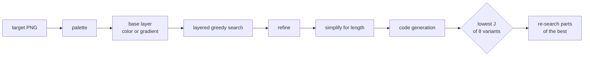

# cssynth

A compiler from images to short HTML/CSS. It is aimed at
[CSSBattle](https://cssbattle.dev) targets: flat 400×300 pictures that players
redraw in as few characters as they can.

<table>
<tr><th>Target</th><th>Rendered from cssynth's output</th></tr>
<tr>
<td></td>
<td></td>
</tr>
</table>

```html
<body bgcolor=c31c1d><b style="position:fixed;inset:70px 80px 70px 80px;background:#660301;clip-path:polygon(25% 0,75% 0,100% 100%,75% 100%,75% 75%,140px 75%,140px 50%,100px 50%,100px 75%,25% 75%,25% 100%,0 100%)">
```

214 characters, a 99.9% pixel match. The human solution it was rendered from
is 493 characters even after minifying.

**[See all 66 targets, outputs and generated code on the results page →](https://fmindstormer.github.io/cssynth/)**

**[Try it on your own picture, in your browser →](https://fmindstormer.github.io/cssynth/demo/)**

## Results

On a benchmark of 66 targets, rendered in Chromium and compared pixel by pixel:

| | |
|---|---|
| Shorter than the human solution (minified) | **53 of 66** |
| Total code length | **24,463** characters (human: 35,532) |
| Targets at ≥ 99% pixel match | 65 of 66 (lowest 98.99%) |
| Mean pixel match | 99.76% |

The human solutions are readable code from two public repositories, minified
but not golfed. Top CSSBattle players write far shorter code, so these
lengths are a baseline, not a leaderboard. The full results, with every
target, output and generated program, are on the
[results page](https://fmindstormer.github.io/cssynth/) (built from
`bench/cssynth-results.html`).

### What each part buys

Each row recompiles all 66 targets with one technique switched off
(`bench/ablation.py`, run by the **Ablation** workflow). Scores come from
cssynth's own rasterizer rather than Chromium, and the parts overlap, so the
rows don't add up.

| Switched off | Total J | Characters | Shorter than human |
|---|---|---|---|
| nothing (full compiler) | 66,081 | 24,463 | 53 / 66 |
| Insertion at any depth (shapes go on top) | 72,100 (+9.1%) | 26,456 (+1,993) | 49 / 66 |
| Re-search of the best result | 70,549 (+6.8%) | 25,975 (+1,512) | 51 / 66 |
| Polygons traced from outlines | 69,162 (+4.7%) | 27,492 (+3,029) | 49 / 66 |
| Gradient backgrounds | 68,615 (+3.8%) | 25,017 (+554) | 52 / 66 |
| Length-aware clean-up | 67,358 (+1.9%) | 26,454 (+1,991) | 50 / 66 |
| Splitting regions that touch at corners | 67,323 (+1.9%) | 25,215 (+752) | 52 / 66 |
| Box-shadows | 67,070 (+1.5%) | 25,470 (+1,007) | 53 / 66 |
| Soft gradient stops | 66,739 (+1.0%) | 24,901 (+438) | 52 / 66 |
| Per-tag rules (`<i>`, `<u>`, `<s>`) | 66,554 (+0.7%) | 24,964 (+501) | 52 / 66 |
| Exact (CP-SAT) shadow grouping, greedy kept | 66,196 (+0.2%) | 24,576 (+113) | 53 / 66 |
| `clip-path` reuse for copies and mirrors | 66,188 (+0.2%) | 24,698 (+235) | 52 / 66 |

Inserting shapes below existing ones, the re-search and outline polygons
matter most. Exact shadow grouping and `clip-path` reuse are small on
average but decide a few targets.

## Usage

```sh
pip install .
cssynth target.png           # prints the code; length and details on stderr
cssynth -v target.png        # also logs the search
cssynth --rho 2 target.png   # golf harder (see "Objective")
cssynth --fast target.png    # skip the re-search: about 2x faster, longer code
```

From Python:

```python
from cssynth import compile_image
code, info, model = compile_image("target.png")
```

## Objective

Everything is scored by one number:

    J = characters + wrong pixels / rho

`rho` is how many wrong pixels the compiler accepts to save one character
(default 0.5). CSSBattle tells players to reach a 100% match before cutting
characters, so the default is cautious; `bench/tradeoff.py` measures what
larger values buy.

## How it works

A longer write-up of the method, with the reasoning behind each part, is in
[docs/method.md](docs/method.md).



1. **Palette** (`search.extract_palette`): flat colors with at least 40
   pixels. A color lying between two others counts as antialiasing only when
   its pixels form thin lines (nothing survives one erosion); a solid region
   of such a color is a real fill, e.g. a semi-transparent shape.
2. **Base layer**: a flat background color, or for striped pictures a
   hard-stop `linear-gradient` (`search.fit_gradient`). Every pixel center is
   projected onto the gradient line for each angle (1° scan, then refined);
   dynamic programming over 1-px bins then chooses band boundaries minimizing
   wrong pixels + a penalty per stop. Chromium evaluates gradients at pixel
   centers and does not antialias hard stops, so a target edge drawn by a
   rotated box leaves a band of wrong pixels; each boundary is then moved to
   a sub-pixel position and given a short linear ramp (a soft stop, `#a
   159.5px,#b 160.5px`) where that pays for its characters. Chromium draws
   these within 3/255 of the model.
3. **Layered greedy search** (`search.greedy`): repeatedly add the shape that
   fixes the most wrong pixels. Candidates come from connected regions of wrong
   pixels (and, where a region only holds together at corners, from each of its
   edge-connected parts): boxes, ellipses, boxes with various corner radii, a
   45° diamond, a plain and a rounded bar along the region's principal axis, a
   leaf (a square rounded on two opposite corners, turned onto that axis), and
   `clip-path` polygons, both from
   the region's convex hull (3–5 vertices) and traced from its outline, which
   may be concave (4–12 vertices, simplified by Visvalingam's algorithm). The
   plain bounding box of each color's largest regions is always climbed too:
   from there a climb peels a compound region (a cross, an I-beam) down to its
   biggest bar. The best starts (each at its best depth) are hill-climbed on
   their edges, radii, rotation or vertices; box gains come from a summed-area
   table and a polygon vertex move only re-tests the pixels near it. A shape may be inserted **at any depth** in the stack: for each
   depth the gain is computed against the canvas below it and only the pixels
   that the shapes above leave visible. This is what lets it build rings and
   nested figures.
4. **Refine** (`search.refine`): merge two touching same-color shapes into one
   when that costs fewer than `min_gain` pixels; re-fit each shape against its
   final surroundings; delete shapes that no longer fix enough pixels; snap
   coordinates to multiples of 5/10 when it changes nothing.
5. **Simplify for length** (`simplify.simplify`): local moves scored by J,
   with code length measured by running the real code generator: drop a
   shape; drop a polygon vertex and re-fit; snap two near-equal shapes to
   identical (or uniformly grown) geometry so they can become box-shadows of
   one another or share CSS (also turned copies at different angles), then
   re-position; make odd sizes even so `padding` can size the box.
6. **Code generation** (`codegen.emit`):
   - paint-order constraints: shape *i* must stay below *j* if they overlap
     with different colors;
   - **box-shadow grouping**, solved exactly (`make_groups_exact`, CP-SAT):
     each shape is an element or a shadow of one compatible element; each
     gets a paint position, shadows share their anchor's, and for every
     constrained pair (i below j) the positions strictly increase unless both
     are in the same group, which excludes cycles between groups. The
     objective is the characters of elements, shadow entries and
     `box-shadow:` overhead. A greedy grouping also runs; the shorter final
     code wins;
   - box-shadow spreads are only used where CSS keeps the shape exact (CSS
     bends a shadow's corner radius when the spread exceeds it);
   - elements are unclosed `<b>` tags with `position:fixed`, except rotated or
     clipped ones, which are closed because they'd transform/clip descendants;
   - sizes via unitless `padding` (quirks mode) or `inset` when shorter;
   - saturated corner radii get the shortest equivalent spelling (`7em`);
   - shortest color spelling; background via `<body bgcolor=...>` or a
     gradient rule;
   - properties shared by every element move into one `b{...}` rule, in a
     `<style>` at the very end of the document, left unclosed along with its
     last rule (the parser closes both at end of input);
   - families of alike elements (same size and corners, same color, or both)
     can move to their own tag, `<i>`, `<u>` or `<s>`, with their own rule,
     which is how copies of a shape at different angles share their CSS;
   - a polygon that is a copy or mirror image of another reuses its
     `clip-path` with `scale:-1 1`, `1 -1` or `-1`, so the two can share it
     in a rule (the clean-up snaps near-mirrors to exact ones).
7. **Choose** (`compiler.VARIANTS`): eight search settings run per image, from
   six searches (two of them also report where a higher `min_gain` would have
   stopped); each result is simplified and scored by J, and the lowest J
   wins. Outline polygons run as separate variants because the greedy search
   can also take them where boxes and shadows would end up shorter.
8. **Re-search** (`improve.improve`): the greedy search commits to shapes in
   the order they first help, so an early polygon can take a region that a
   shorter primitive would have drawn. The best result is taken apart and
   refilled: one polygon at a time (refilled without polygons of its color),
   then every shape of one color (refilled as before, and without polygons).
   Each refill is refined and simplified, and kept when J drops. `--fast`
   skips this step.

## Benchmark

`bench/` holds the 66 cases (`cases.json`), the generated code and its renders
(`out/`), and the scores (`results.json`, plus `results_v1.json` and `out_v1/`
from the first version for comparison).

Targets are Chromium renders of public human solutions, so each target is
exactly reproducible. Match = share of pixels within 8/255 per channel of the
target, measured on Chromium's render of the generated code.

- 31 cases come from [OmPreetham/cssbattle](https://github.com/OmPreetham/cssbattle)
  (MIT); their code and targets are included.
- 35 come from [Kushalshakya/CSSBattle](https://github.com/Kushalshakya/CSSBattle),
  which has no license, so the repository keeps only their metadata.
  `bench/fetch.py` downloads them at a pinned commit, checks them against
  `cases.json` and renders the targets. See [THIRD_PARTY.md](THIRD_PARTY.md).

```sh
cd bench && npm ci && cd ..         # puppeteer-core + @sparticuz/chromium
python bench/fetch.py               # download and render the remaining targets
python bench/run.py                 # compile all, render in Chromium, score
python bench/reemit.py              # re-run only code generation on saved shapes
python bench/tradeoff.py            # characters vs match for several rho
python bench/build_page.py          # results page -> bench/cssynth-results.html
```

The targets were rendered with `@sparticuz/chromium` 131 on Linux, which only
runs there. Elsewhere, point `CHROME_PATH` at Chrome for Testing 131
(`npx @puppeteer/browsers install chrome@131.0.6778.204`). Its edges differ
slightly from the Linux build: the human solutions themselves match their
Linux targets by 99.8% on average on macOS (99.1% at worst), which lowers
match scores by the same amount. The generated code is the same on both. The
committed results and the trade-off table come from the **Benchmark**
workflow, which runs everything on Linux (about 25 minutes on GitHub's
runners).

## Development

```sh
pip install -e ".[dev]"
pytest          # unit tests and small end-to-end compiles, ~20 s
ruff check .
```

```
cssynth/
  compiler.py   compile_image: run the variants, simplify, keep the lowest J
  improve.py    re-search: take the best result apart and refill it
  search.py     palette, base layer, greedy shape search, refine
  shapes.py     the Shape model and a rasterizer that predicts Chromium's
  simplify.py   length-aware clean-up moves
  codegen.py    golfed HTML/CSS, including the CP-SAT shadow grouping
bench/          benchmark data, runner and results page
demo/           the in-browser demo (Pyodide) and a local Gradio app
tests/
```

## Open problems

- **Search for structure.** The greedy still adds whatever fixes the most
  pixels next, and the re-search only repairs its choices locally: the lotus
  is still drawn with polygons where a golfer uses three rotated leaves.
  Scoring partial programs by their final code length during the search
  (e.g. beam search over J) is the next step.
- **Reuse.** Turned copies of a box share a rule and mirrored copies of a
  polygon share a `clip-path`, but nothing yet uses `::before`/`::after` to
  repeat a shape, or mirrors a rounded box.
- **More primitives.** Gradients on boxes (not only the background), borders
  (only a handful of the human solutions use them, for frames and outlined
  shapes), text. Two were measured and left out: `repeating-*-gradient` (only
  one benchmark target repeats a band pattern, and its output is already half
  the human length) and a `radial-gradient` background for a circle (8
  targets start with one, but `circle at …` plus soft stops costs about as
  much as the element; at best 34 characters in total).
- **Antialiasing.** A soft stop's linear ramp only approximates how Chromium
  smooths a rotated edge, so striped flags still carry a few hundred wrong
  pixels, and so do some rotated shapes.
- **Speed.** A full benchmark run takes about 100 CPU-minutes on GitHub's
  runners, about two thirds of it re-search (`--fast` skips it), most of it
  in hill climbs on rotated shapes and polygons.

## License

MIT, see [LICENSE](LICENSE). Third-party benchmark material is described in
[THIRD_PARTY.md](THIRD_PARTY.md). Not affiliated with CSSBattle.
