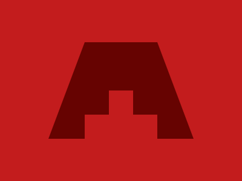
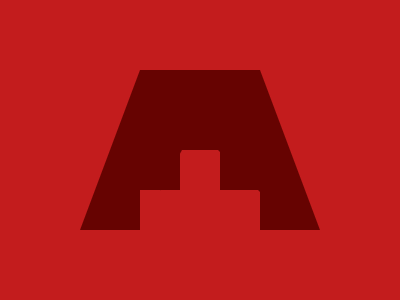
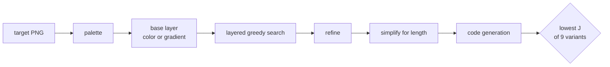

# cssc

A compiler from images to short HTML/CSS. It is aimed at
[CSSBattle](https://cssbattle.dev) targets: flat 400×300 pictures that players
redraw in as few characters as they can.

<table>
<tr><th>Target</th><th>Rendered from cssc's output</th></tr>
<tr>
<td></td>
<td></td>
</tr>
</table>

```html
<body bgcolor=c31c1d><b style="position:fixed;inset:70px 80px 70px 80px;background:#660301;clip-path:polygon(25% 0,75% 0,100% 100%,75% 100%,75% 75%,140px 75%,140px 50%,100px 50%,100px 75%,25% 75%,25% 100%,0 100%)">
```

214 characters, pixel-perfect. The human solution it was rendered from is 493
characters even after minifying.

## Results

On a benchmark of 66 targets, rendered in Chromium and compared pixel by pixel:

| | |
|---|---|
| Shorter than the human solution (minified) | **50 of 66** |
| Total code length | **27,426** characters (human: 35,532) |
| Targets at ≥ 99% pixel match | 63 of 66 (lowest 98.8%) |
| Mean pixel match | 99.64% |

The human solutions are readable code from two public repositories, minified
but not golfed. Top CSSBattle players write far shorter code, so these
lengths are a baseline, not a leaderboard. The full results, with every
target, output and generated program, are on the results page
(`bench/cssc-results.html`, published through GitHub Pages).

## Usage

```sh
pip install .
cssc target.png              # prints the code; length and details on stderr
cssc -v target.png           # also logs the search
cssc --rho 2 target.png      # golf harder (see "Objective")
```

From Python:

```python
from cssc import compile_image
code, info, model = compile_image("target.png")
```

## Objective

Everything is scored by one number:

    J = characters + wrong pixels / rho

`rho` is how many wrong pixels the compiler accepts to save one character
(default 0.5). CSSBattle tells players to reach a 100% match before cutting
characters, so the default is cautious; `bench/tradeoff.py` measures what
larger values buy.

## How it works



1. **Palette** (`search.extract_palette`): flat colors with at least 40
   pixels. A color lying between two others counts as antialiasing only when
   its pixels form thin lines (nothing survives one erosion); a solid region
   of such a color is a real fill, e.g. a semi-transparent shape.
2. **Base layer**: a flat background color, or for striped pictures a
   hard-stop `linear-gradient` (`search.fit_gradient`). Every pixel center is
   projected onto the gradient line for each angle (1° scan, then refined);
   dynamic programming over 1-px bins then chooses band boundaries minimizing
   wrong pixels + a penalty per stop. Chromium does not antialias hard stops,
   so the model samples pixel centers only (matches Chromium to 2–3 pixels).
3. **Layered greedy search** (`search.greedy`): repeatedly add the shape that
   fixes the most wrong pixels. Candidates come from connected regions of wrong
   pixels: boxes, ellipses, boxes with various corner radii, a 45° diamond, a
   bar along the region's principal axis, and `clip-path` polygons, both from
   the region's convex hull (3–5 vertices) and traced from its outline, which
   may be concave (4–12 vertices, simplified by Visvalingam's algorithm). The
   plain bounding box of each color's largest regions is always climbed too:
   from there a climb peels a compound region (a cross, an I-beam) down to its
   biggest bar. Each candidate is hill-climbed on its edges, radii, rotation or
   vertices. A shape may be inserted **at any depth** in the stack: for each
   depth the gain is computed against the canvas below it and only the pixels
   that the shapes above leave visible. This is what lets it build rings and
   nested figures.
4. **Refine** (`search.refine`): merge two touching same-color shapes into one
   when that costs fewer than `min_gain` pixels; re-fit each shape against its
   final surroundings; delete shapes that no longer fix enough pixels; snap
   coordinates to multiples of 5/10 when it changes nothing.
5. **Simplify for length** (`simplify.simplify`): local moves scored by J,
   with code length measured by running the real code generator: drop a
   shape; drop a polygon vertex and re-fit; snap two near-equal shapes to
   identical (or uniformly grown) geometry so they can become box-shadows of
   one another or share CSS, then re-position; make odd sizes even so
   `padding` can size the box.
6. **Code generation** (`codegen.emit`):
   - paint-order constraints: shape *i* must stay below *j* if they overlap
     with different colors;
   - **box-shadow grouping**, solved exactly (`make_groups_exact`, CP-SAT):
     each shape is an element or a shadow of one compatible element; each
     gets a paint position, shadows share their anchor's, and for every
     constrained pair (i below j) the positions strictly increase unless both
     are in the same group, which excludes cycles between groups. The
     objective is the characters of elements, shadow entries and
     `box-shadow:` overhead. A greedy grouping also runs; the shorter final
     code wins;
   - box-shadow spreads are only used where CSS keeps the shape exact (CSS
     bends a shadow's corner radius when the spread exceeds it);
   - elements are unclosed `<b>` tags with `position:fixed`, except rotated or
     clipped ones, which are closed because they'd transform/clip descendants;
   - sizes via unitless `padding` (quirks mode) or `inset` when shorter;
   - saturated corner radii get the shortest equivalent spelling (`7em`);
   - shortest color spelling; background via `<body bgcolor=...>` or a
     gradient rule;
   - properties shared by every element move into one `b{...}` rule, in a
     `<style>` at the very end of the document, left unclosed along with its
     last rule (the parser closes both at end of input).
7. **Choose** (`compiler.VARIANTS`): nine search settings run per image; each
   result is simplified and scored by J, and the lowest J wins. Outline
   polygons run as separate variants because the greedy search can also take
   them where boxes and shadows would end up shorter.

## Benchmark

`bench/` holds the 66 cases (`cases.json`), the generated code and its renders
(`out/`), and the scores (`results.json`, plus `results_v1.json` and `out_v1/`
from the first version for comparison).

Targets are Chromium renders of public human solutions, so each target is
exactly reproducible. Match = share of pixels within 8/255 per channel of the
target, measured on Chromium's render of the generated code.

- 31 cases come from [OmPreetham/cssbattle](https://github.com/OmPreetham/cssbattle)
  (MIT); their code and targets are included.
- 35 come from [Kushalshakya/CSSBattle](https://github.com/Kushalshakya/CSSBattle),
  which has no license, so the repository keeps only their metadata.
  `bench/fetch.py` downloads them at a pinned commit, checks them against
  `cases.json` and renders the targets. See [THIRD_PARTY.md](THIRD_PARTY.md).

```sh
cd bench && npm ci && cd ..         # puppeteer-core + @sparticuz/chromium
python bench/fetch.py               # download and render the remaining targets
python bench/run.py                 # compile all, render in Chromium, score
python bench/reemit.py              # re-run only code generation on saved shapes
python bench/tradeoff.py            # characters vs match for several rho
python bench/build_page.py          # results page -> bench/cssc-results.html
```

The targets were rendered with `@sparticuz/chromium` 131 on Linux, which only
runs there. Elsewhere, point `CHROME_PATH` at Chrome for Testing 131
(`npx @puppeteer/browsers install chrome@131.0.6778.204`). Its edges differ
slightly from the Linux build: the human solutions themselves match their
Linux targets by 99.8% on average on macOS (99.1% at worst), which lowers
match scores by the same amount. The committed results were measured this way
on macOS; the **Benchmark** workflow re-runs everything on Linux.

## Development

```sh
pip install -e ".[dev]"
pytest          # unit tests and small end-to-end compiles, ~20 s
ruff check .
```

```
cssc/
  compiler.py   compile_image: run the variants, simplify, keep the lowest J
  search.py     palette, base layer, greedy shape search, refine
  shapes.py     the Shape model and a rasterizer that predicts Chromium's
  simplify.py   length-aware clean-up moves
  codegen.py    golfed HTML/CSS, including the CP-SAT shadow grouping
bench/          benchmark data, runner and results page
tests/
```

## Open problems

- **Search for structure.** The greedy still adds whatever fixes the most
  pixels next; length only enters afterwards. Scoring partial programs by
  their final code length during the search (e.g. beam search over J) is the
  next step.
- **Reuse.** A shape repeated with a rotation or mirror (a common CSSBattle
  pattern) is written out each time; box-shadows only cover translated copies.
  Different tag names as free selectors would let groups share geometry.
- **More primitives.** Borders (39 of the 66 human solutions use them),
  repeated patterns via `repeating-*-gradient`, gradients on boxes (not only
  the background), text.
- **Antialiasing.** Hard gradient stops and some rotated edges differ from the
  target's antialiasing by a pixel band, which caps the match on a few flags.
- **Speed.** A full benchmark run takes about 80 CPU-minutes; most variants
  could stop early once they are clearly beaten.

## License

MIT, see [LICENSE](LICENSE). Third-party benchmark material is described in
[THIRD_PARTY.md](THIRD_PARTY.md). Not affiliated with CSSBattle.
